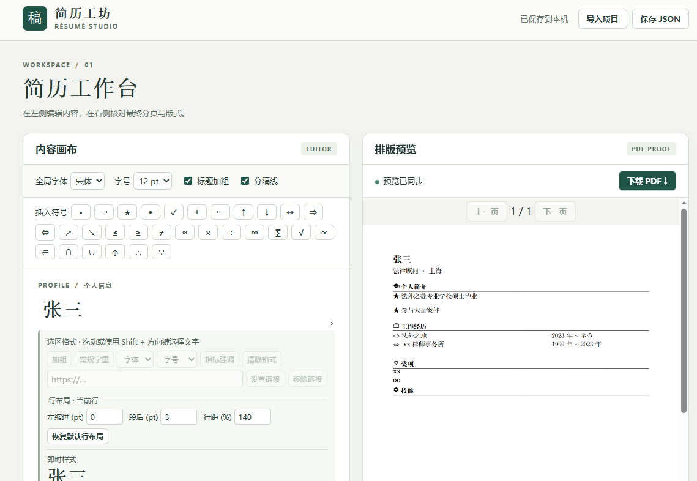

# SimpleResume

一个本地优先的中文简历编辑器。像编辑普通文档一样调整文字、章节和样式，不用写 LaTeX；右侧显示 XeLaTeX 排出的真实 PDF，下载的就是已预览的版本。



## 下载与运行

1. 从 [GitHub Releases](https://github.com/cryer/SimpleResume/releases) 下载 **Windows x64** 发布包并解压。
2. 安装 [TeX Live](https://www.tug.org/texlive/) 或配置 [TinyTeX](https://yihui.org/tinytex/)，确保 `xelatex --version` 和 `xdvipdfmx --version` 能在终端执行。中文模板使用 `ctex`、`geometry`、`fandol` 和 `lm-math`；精简 TeX 安装可用 `tlmgr install ctex geometry fandol lm-math` 补齐。修改 PATH 后重新启动程序。
3. 打开解压目录中的 `.exe`。如果系统缺少 WebView2，请安装 [Microsoft Edge WebView2 Runtime](https://developer.microsoft.com/microsoft-edge/webview2/)。应用不会自动下载 TeX 或上传简历。

## 能做什么

- **编辑与排版**：增删、重排章节；选中文字单独调整字重、字号、宋/黑/楷字体。支持数字强调、可点击的 HTTP(S) 链接、19 种章节图标和 30 个符号。可逐行调缩进、行距和段后距，保留文字中间的连续空格。
- **预览与导出**：编辑立即更新，后台防抖编译。失败时保留上次成功的校样，但不会把旧 PDF 当成当前版本下载。桌面端保存到系统下载目录，不覆盖同名文件。
- **保存与迁移**：自动暂存当前草稿，也可将简历保存为版本化 JSON 项目文件，之后重新打开。支持结构化编辑，不支持导入任意 `.tex` 无损往返。

## 平台支持

| 平台 | 当前状态 | 发布产物 |
| --- | --- | --- |
| Windows x64 | 已验证桌面编辑、真实中文 PDF 编译、预览和导出 | 提供 Windows x64 可执行程序 |
| macOS / Linux | Tauri 和 Rust 有对应平台实现，但尚未在这些系统上验证原生构建、桌面启动时的 TeX 查找和完整导出流程 | 暂不提供 `.app`、`.dmg`、`.deb` 或 AppImage |
| 现代浏览器 | 可从源码运行编辑画布；浏览器不能直接启动本地 XeLaTeX | 无独立 PDF 排版服务 |

因此本项目**有跨平台架构，不代表各平台均已获支持**。

## 从源码运行

准备 Node.js 24、npm、稳定版 Rust、[Tauri 2 系统依赖](https://v2.tauri.app/start/prerequisites/) 和上述 TeX 环境。Windows 构建需要 MSVC C++ Build Tools。

```sh
git clone https://github.com/cryer/SimpleResume.git
cd SimpleResume
npm ci
npm run desktop                       # 桌面开发模式
npm run dev                           # 仅运行网页编辑器
npm run desktop:build -- --no-bundle  # 构建可执行程序，不制作安装器
```

Windows 本地构建结果在 `src-tauri/target/release/resume-studio.exe`。项目不包含 TeX 安装目录、依赖缓存或编译产物。前端使用 React、TypeScript 和 PDF.js；`src-tauri/` 的 Rust 宿主验证文档并运行受限的 XeLaTeX 子进程。[后端说明](src-tauri/README.md) 列出了文件访问和资源限制。

### 验证

```sh
npm test
npm run test:ui
npm run build
cd src-tauri
cargo fmt --check
cargo test --locked -- --include-ignored
cargo clippy --locked --all-targets -- -D warnings
```

浏览器测试会从仓库中的 `.tex` 源文件生成两字样例 PDF，不分发内嵌字体的测试成品。默认使用 Edge；其他环境可安装 Playwright Chromium 并设置 `PLAYWRIGHT_CHANNEL=chromium`。完整 Rust 测试还需要 `pdftotext` 在 PATH 上以及项目根目录的 npm 依赖。

## 许可

项目原创源码按 [MIT License](LICENSE) 发布；第三方依赖、PDF.js 资源及其字体等仍适用各自许可。
